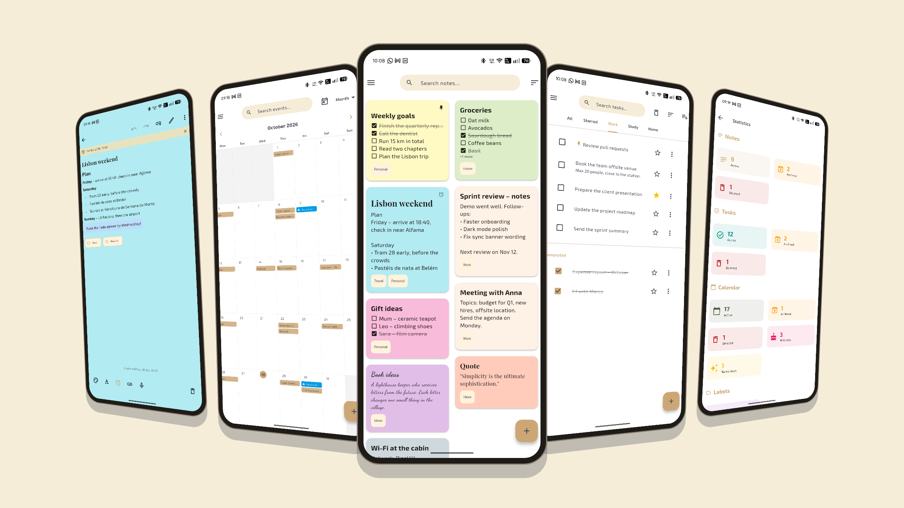
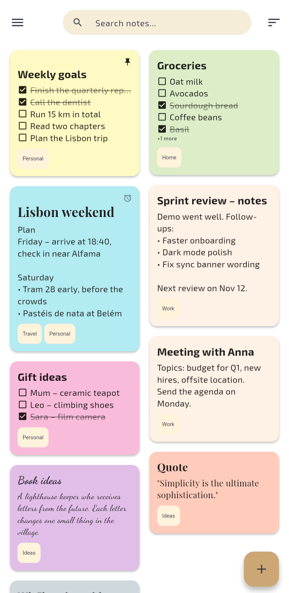
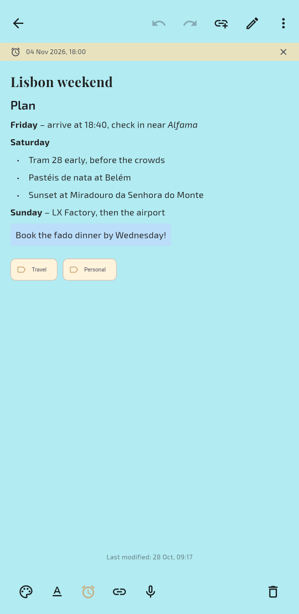
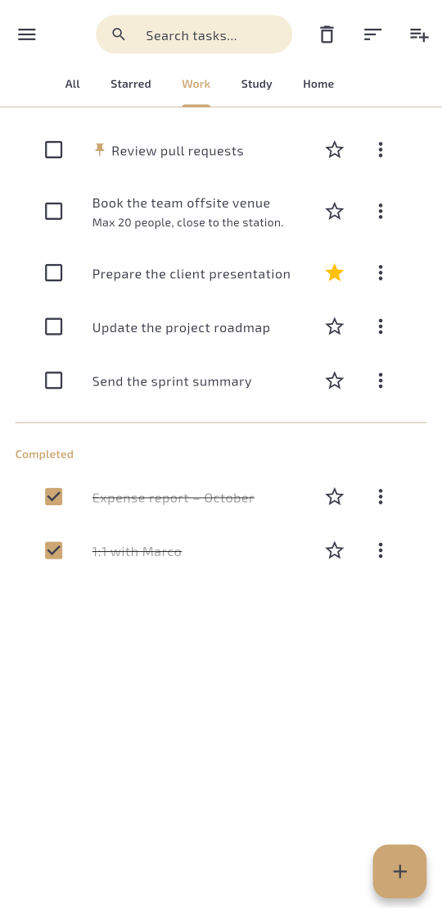
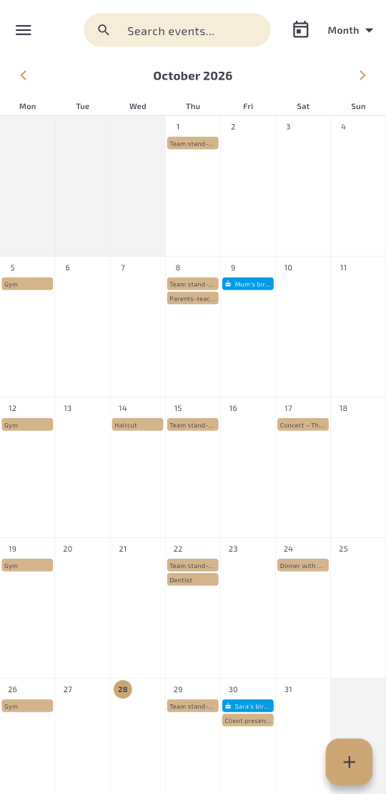
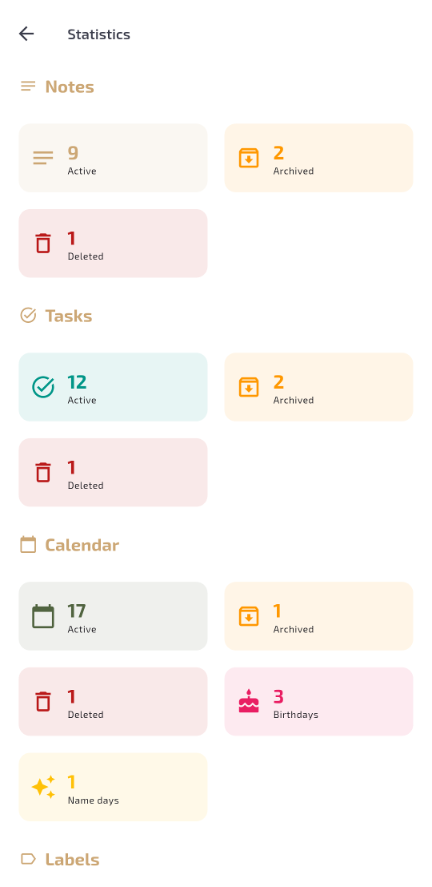

<div align="center">


# Noteep

**A digital notebook for Android, built with Flutter.**

Notes, checklists, tasks and calendar events in one place, with reminders, labels and audio notes.<br>
Synced to your account with Firebase, with backups, PDF export, Home screen widgets, Italian and English, light and dark theme.

[](https://github.com/ndenicolais/Noteep/releases/latest)
[](#requirements)
[](https://flutter.dev)
[](LICENSE)

[**📥 Download the APK**](#download) · [Features](#features) · [Documentation](DOCUMENTATION.md) · [Privacy](PRIVACY.md)

<br>



</div>

---

## Screenshots

| Home | Note editor | Tasks | Calendar | Statistics |
|:---:|:---:|:---:|:---:|:---:|
|  |  |  |  |  |

---

## Features

| | |
|---|---|
| 📝 **Notes** | Text notes with Markdown preview and checklists, each with its own font and colors, in a grid or a list |
| 🎙️ **Audio notes** | Record voice notes and play them back inside a note |
| ✅ **Tasks** | Custom lists, subtasks, due dates, recurrence, starred and pinned tasks |
| 📅 **Calendar** | Day, week, month, year and schedule views, with recurring events, birthdays and name days |
| ⏰ **Reminders** | Notifications for notes, tasks and events, with note and task reminders in one screen |
| 🏷️ **Labels** | Organize notes with labels and open all the notes of a label |
| 🗂️ **Archive and trash** | Archive what you don't need now, restore deleted items within 7 days |
| 📊 **Statistics** | Overview of notes, tasks and events |
| 📤 **Export and backup** | Notes as PDF, TXT, CSV, HTML or JSON, full backups and calendar import/export in ICS |
| 📱 **Home screen widgets** | A summary widget and quick actions to create a note, task or event |
| 🔐 **Authentication** | Sign in with a Google account or email and password |
| ☁️ **Sync** | Notes, tasks, lists, labels and events are stored on Cloud Firestore, and changes made offline sync later |
| 🌍 **Multilingual** | Italian and English |
| 🌗 **Theme** | System / Light / Dark theme |

---

## Download

<a href="https://github.com/ndenicolais/Noteep/releases/latest"></a>

Noteep is distributed as an APK on [GitHub Releases](https://github.com/ndenicolais/Noteep/releases), not on the Play Store. It needs Android 7.0+ on a 64-bit (arm64) device with Google Play services.

1. Download the APK on your phone and open it.
2. If asked, allow your browser or file manager to **install unknown apps**.
3. Confirm the installation.

> [!NOTE]
> **"App blocked to protect your device" (Google Play Protect).** Play Protect shows this warning for apps that are not distributed through the Play Store and whose developer it does not know yet. Tap **More details → Install anyway** to continue. The source code of every release is available in this repository.

> [!IMPORTANT]
> **Updating from Noteep 1.0.0:** releases are now signed with a new key, so Android cannot update the old app in place. Uninstall the previous version first, then install the new APK. Notes, tasks and events are stored in your account and come back as soon as you sign in; audio recordings and automatic backups are kept only on the device and are removed with the old app.

---

## Architecture

| Layer | Technology |
|---|---|
| Framework | Flutter 3 / Dart |
| State management | Riverpod |
| Cloud database | Cloud Firestore (with offline persistence) |
| Authentication | Firebase Auth + Google Sign In |
| Local persistence | SharedPreferences, app documents folder (audio, backups) |
| Fonts | Exo 2, plus five note fonts (bundled) |
| Icons | Material Icons |
| Notifications | flutter_local_notifications, timezone |
| Audio | record, just_audio |
| Charts | fl_chart |
| Home screen widgets | home_widget + native Kotlin widgets |
| Export | pdf, printing, share_plus, archive |

<details>
<summary><b>Project structure</b></summary>

```
lib/
├── main.dart                  # Entry point, auth gate
├── core/                      # Version, changelog, app info, routing and deep links
├── l10n/                      # ARB localization files (it, en)
├── models/                    # Notes, tasks, lists, labels, events
├── providers/                 # Riverpod providers, one per domain
├── screens/                   # One folder per complex screen
├── theme/                     # Colors, font sizes, spacing, radii, ThemeData
├── utils/                     # Notifications, backup, ICS, audio, widgets
└── widgets/                   # Shared widgets and design-system components
```

</details>

---

## Build from source

### Requirements

- Flutter SDK 3.44 or later (Dart SDK 3.7.2 or later)
- Android 7.0+ (API 24+), 64-bit (arm64), with Google Play services
- Internet connection (for authentication and Firestore sync)
- A Firebase project with Authentication and Cloud Firestore, configured with [`flutterfire configure`](https://firebase.google.com/docs/flutter/setup): it creates `android/app/google-services.json` and `lib/firebase_options.dart` (both git-ignored)

### Run

```bash
# Clone the repository
git clone https://github.com/ndenicolais/Noteep.git
cd Noteep

# Install dependencies
flutter pub get

# Run the app
flutter run
```

Release builds are signed with the keystore set in `android/key.properties` (see [DOCUMENTATION.md](DOCUMENTATION.md)); without it, they fall back to the debug key.

---

## Documentation

For detailed documentation of every feature, data model, screen and technical choice, see [DOCUMENTATION.md](DOCUMENTATION.md). How personal data is handled is described in the [privacy policy](PRIVACY.md).

---

## License

Copyright © 2026 Nicola De Nicolais — All rights reserved.
Released under a **source-available, non-commercial** license — see [LICENSE](LICENSE) for details.
Commercial use, including publishing on any app store, requires the author's written permission.

<div align="center">

Made by **Nicola De Nicolais** · [ndn21dev@gmail.com](mailto:ndn21dev@gmail.com) · [GitHub](https://github.com/ndenicolais)

</div>
